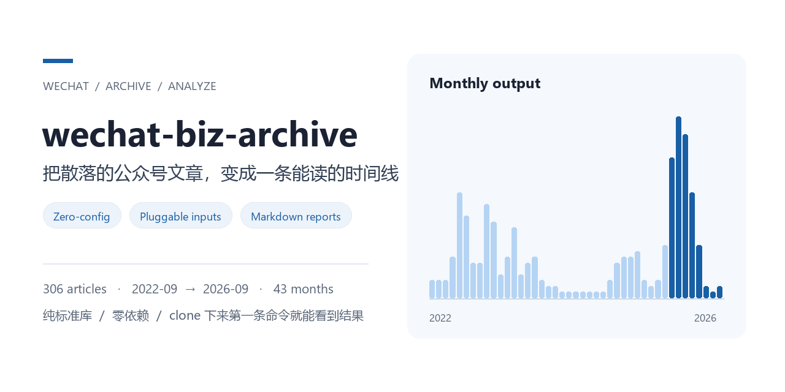

<p align="center">
  
</p>

# wechat-biz-archive

[](https://github.com/strangeyu911-tech/wechat-biz-archive/actions/workflows/ci.yml)
[](https://www.python.org/)
[](LICENSE)

**把散落的公众号文章，变成一条能读的时间线。**

给它任意一份文章清单（CSV、URL 列表、本机聊天记录导出、检索结果，或完整的公众号历史），
它输出：时间线、月度分布、活跃阶段划分、最早文章清单，以及一份 Markdown 归档报告。

纯标准库、零依赖、跨平台。**clone 下来第一条命令就能看到结果。**

---

## 效果先看这里

仓库随附一份真实跑出来的示例：[`examples/demo_report.md`](examples/demo_report.md)

```
文章 306 篇 · 2022-09-09 ~ 2026-09-20 · 覆盖 43 个月

2022-09    3  ###
2022-12    7  ######
2023-01   18  ################
2025-12   31  ##############################
2026-01   28  ############################
```

同一份数据自动切出的活跃阶段（既看断更空档，也看月产量的跃升）：

| 起 | 止 | 月份数 | 篇数 | 月均 |
|---|---|---|---|---|
| 2022-09 | 2022-12 | 4 | 16 | 4.0 |
| 2023-01 | 2024-03 | 15 | 120 | 8.0 |
| 2024-05 | 2024-07 | 3 | 3 | 1.0 |
| 2024-09 | 2024-09 | 1 | 1 | 1.0 |
| 2024-11 | 2025-10 | 12 | 51 | 4.2 |
| **2025-11** | **2026-03** | **5** | **110** | **22.0** |
| 2026-06 | 2026-06 | 1 | 2 | 2.0 |
| 2026-08 | 2026-09 | 2 | 3 | 1.5 |

2025 年秋月均从 4.2 篇跃升到 22 篇——这个号明显换了更新节奏。
这类结论靠手动翻公众号主页是很难得出的，而它就是一条时间序列。

---

## 30 秒上手

```bash
git clone https://github.com/strangeyu911-tech/wechat-biz-archive.git
cd wechat-biz-archive
python wba.py
```

不需要 `pip install`，不需要配置，不需要登录任何账号。
会用仓库自带的示例数据生成 `report.md`，并在终端打印摘要。

想装成命令也可以：

```bash
python -m pip install -e .
wechat-biz-archive --input my.csv --out report.md
```

---

## 输入源是可插拔的

```bash
python wba.py --list-providers
```

| 输入源 | 命令示例 | 需要什么 |
|---|---|---|
| `csv` | `--input articles.csv` | 一份 CSV 或一行一个 URL 的 txt |
| `chatlog` | `--provider chatlog --input ./export` | 本机聊天记录导出目录（只读文件） |
| `sogou` | `--provider sogou --query "读研" --account 王赞` | 联网，尽力而为，失败会提示降级 |
| `session` | `--full --biz <__biz> --credentials creds.json` | 本人客户端的会话凭证，见下 |

输出格式随意切：

```bash
python wba.py --input articles.csv --format csv  --out clean.csv
python wba.py --input articles.csv --format json --out articles.json
python wba.py --input articles.csv --format md   --out report.md
```

新增输入源只要写一个继承 `Provider` 的类 + `@register`，不用改 CLI。

---

## 完整历史模式（`--full`）

输入源里 `session` 的效果最好：能拿到一个公众号**全部图文群发**的标题、日期、摘要和完整链接，
自动翻页到 `can_msg_continue=0`，不需要手动滚动、不需要逐篇整理。

```bash
python wba.py --full --biz <__biz> --credentials creds.json --out full_report.md
```

凭证格式见 [`credentials.example.json`](credentials.example.json)，
获取方法与完整排查决策树见 **[`docs/SESSION_PROVIDER.md`](docs/SESSION_PROVIDER.md)**。

> 这份文档是本项目最花心思的部分之一：它把「哪些入口在新版客户端已经不存在、
> 哪些路径实测走不通、参数有哪些编码陷阱、拿到后怎么验证有效性、过期了怎么办」
> 整理成一份可照做的决策树。带 AI agent 的人可以直接让它照着文档在本机把凭证准备好。

另外还有一个**可选的实验性助手** `extras/collect_session.py`，能在本机自动完成收集、
去重与有效性探测：

```bash
python extras/collect_session.py --biz <__biz>
python wba.py --full --biz <__biz> --credentials credentials.json --out full_report.md
```

**主包不内置凭证获取实现**（实验性实现单独放在 `extras/`，默认不参与主流程），
也不保存任何凭证。凭证只在运行时从本地文件或环境变量读取，有效期通常几小时，
`.gitignore` 已排除所有 `credentials*.json`，用完请删除输出文件。

拿不到凭证也完全能用：用 CSV / URL 清单 / 聊天记录导出 / 搜狗检索作为输入，
分析、阶段划分、报告生成全都照常工作。

---

## 为什么做这个

公众号主页是逆序的信息流，越早的内容越难抵达；而「一个号什么时候转型、最早写了什么、
哪个阶段最高产」这类问题，本质上是**时间序列分析**，不是浏览问题。

所以这个工具把问题拆成两层：

1. **输入层**：不管文章清单从哪来，统一成 `Article(title, date, url, mid)`。
2. **分析层**：去重、按月聚合、按空档切活跃阶段、生成可分享的报告。

输入源可以一个一个加，分析层完全不用动。这也是它能做到「clone 就能跑」的原因：
默认自带一份示例数据，高级输入源是增量，不是前置条件。

---

## 数据边界

- 本工具处理的是**公开文章页面的元信息**（标题、发布时间、链接、群发序号），不抓取、不存储、不分发文章正文。
- 示例数据 `examples/demo_articles.csv` 只含上述四个字段，不含摘要、正文、账号凭证或个人信息。
- 完整历史模式仅限**本人设备、本人账号**使用，请遵守对应平台的服务条款，不要高频批量请求，不要用于商业分发。
- 各输入源的边界与降级策略见 [`docs/DATA_SOURCES.md`](docs/DATA_SOURCES.md)。

---

## 项目结构

```
wba.py                          零安装启动器
src/wechat_biz_archive/
  cli.py                       命令行
  models.py                    Article 数据模型
  providers/                   可插拔输入源
    base.py / csv_provider.py / chatlog.py / sogou.py / session.py
  history.py                   完整历史自动翻页
  analyze.py                   去重 / 月度聚合 / 阶段划分
  report.py                    Markdown · CSV · JSON 输出
examples/
  demo_articles.csv            306 篇脱敏示例数据
  demo_report.md               真实跑出来的示例报告
docs/
  SESSION_PROVIDER.md          凭证获取决策树与失败路径清单
  DATA_SOURCES.md              输入源说明与边界
extras/                        实验性、可选，默认不参与主流程
  collect_session.py           本机会话参数收集助手（仅本人设备）
.github/
  workflows/ci.yml             单元测试 + 零配置冒烟测试
  assets/social-preview.png    分享预览图（也可在仓库 Settings 里上传）
tests/                         基础测试
```

---

## 运行测试

```bash
python -m unittest discover -s tests -v
python extras/collect_session.py --self-test
```

CI 在 Python 3.9 / 3.11 / 3.13 上跑同样这些检查，外加零配置冒烟测试和
`pip install -e .` 的入口验证，详见 [`.github/workflows/ci.yml`](.github/workflows/ci.yml)。

---

MIT License · 2026 Strange
